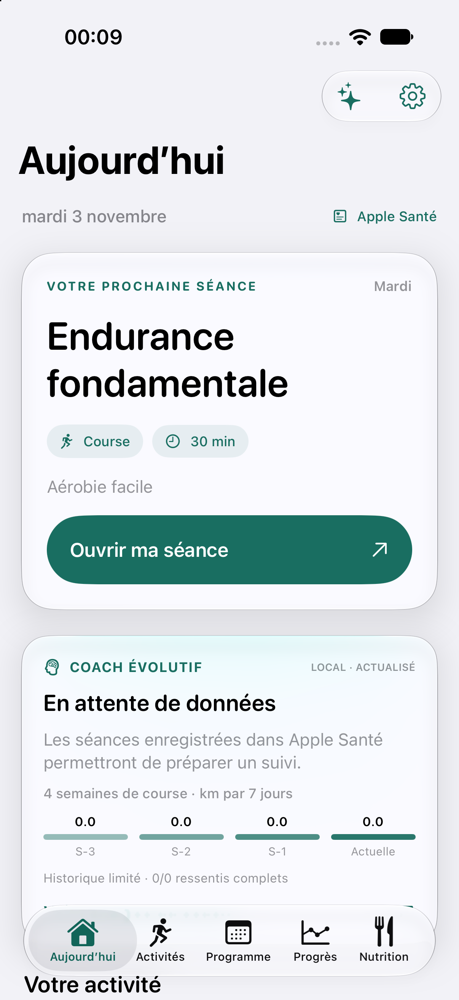
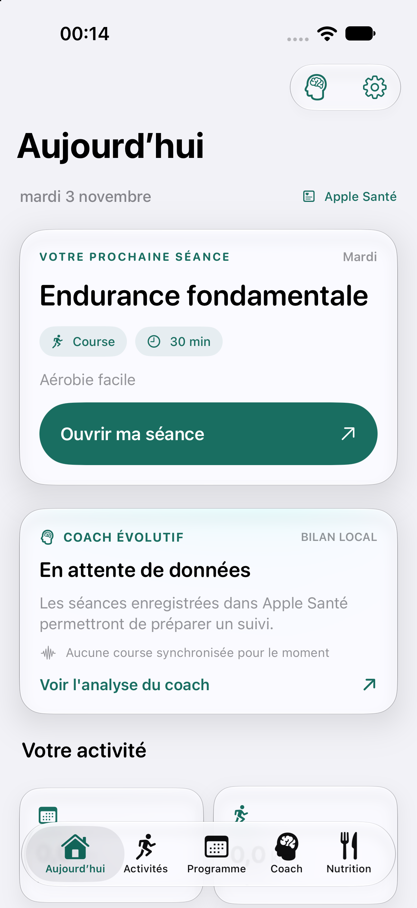
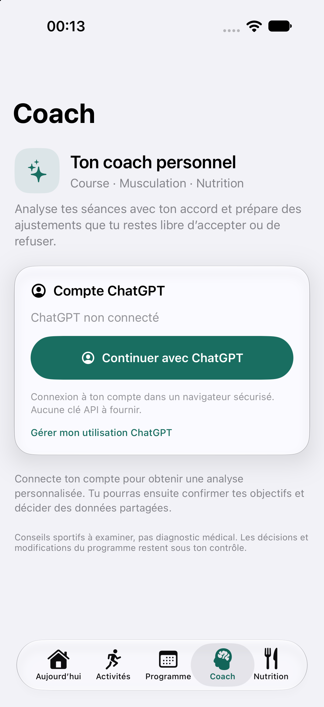
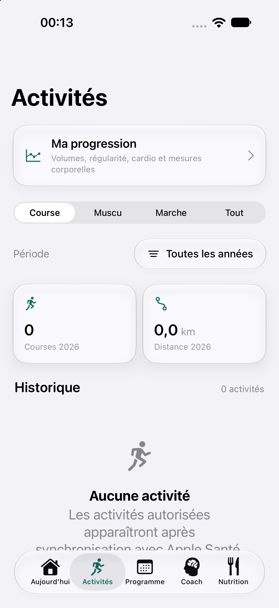
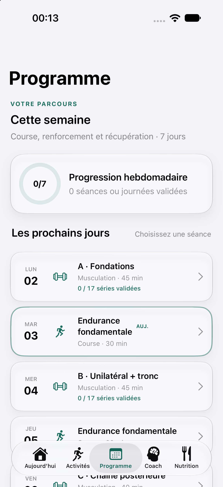
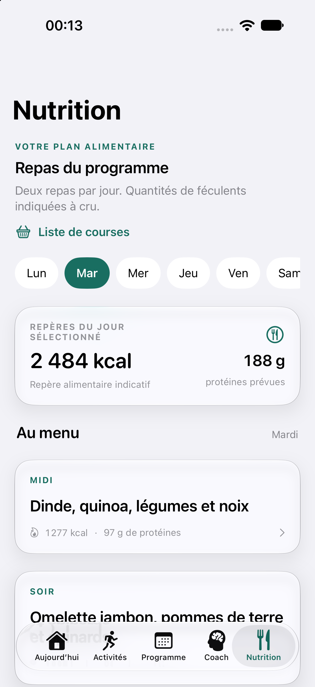

# PACE-LAB V5.5 — Audit du parcours iPhone et améliorations livrées

**Périmètre :** application native SwiftUI, accueil, accès au Coach, activités et progression, programme hebdomadaire, nutrition. Contrôle croisé du code, des tests de navigation et de captures obtenues sur simulateur iPhone 18 Pro (iOS 27). Les données du simulateur sont vides ; l'analyse réelle ChatGPT/HealthKit n'est donc pas simulée.

## Verdict et priorités

L'application dispose déjà d'une identité cohérente : cartes Liquid Glass sobres, accent vert/bleu, typographie système, utilisation mesurée des icônes et boutons principaux lisibles. L'usage « mon Coach gère mes entraînements » souffrait toutefois de **l'absence du Coach en navigation principale**, de **doublons de parcours**, d'une **page d'accueil trop dense** et de **libellés ne différenciant pas toujours une prévision d'une donnée réellement observée**.

Priorité P0 — **Coach accessible à une touche** depuis la navigation inférieure, sans ouvrir systématiquement une feuille modale.
Priorité P0 — **États exacts et transparents**, notamment programme arrivé à échéance, consentement et historique manquant.
Priorité P1 — **Alléger la première vue** : première séance + bilan local condensé, au lieu d'un graphe détaillé avant les actions.
Priorité P1 — **Montrer la boucle Coach** : actif ou non, dernière décision, accès clair à ses autorisations.
Priorité P1 — **Préserver l'accès à Progression** et signaler la divergence entre le rythme souhaité et le programme de référence.
Priorité P2 — **Accessibilité et parcours approfondi** : VoiceOver, Dynamic Type maximum, contrastes réels, tests avec compte ChatGPT connecté.

## Captures et déroulé du parcours

### Étape 1 — Accueil / choisir sa prochaine séance — amélioration confirmée

Avant : une carte de séance très haute, un graphique local occupant une grande partie de l'écran, puis une deuxième entrée « Votre coach ». L'activité récente était rejetée sous la zone visible. La mention « LOCAL · ACTUALISÉ » pouvait laisser croire à une analyse GPT récente.

Après : titre et CTA de séance plus compacts, carte « BILAN LOCAL » courte et séparée des décisions ChatGPT, suppression du CTA redondant. La rubrique Activité devient visible plus tôt. Le passage vers Coach est une navigation d'onglet et non une nouvelle modale. Un cycle expiré affiche désormais « Programme arrivé à échéance » au lieu de « Programme terminé ». Une mention de confidentialité absolue a été remplacée par un texte fondé sur les autorisations de partage.

**État :** bon sur l'écran et sur le code, avec poursuite nécessaire des tests VoiceOver.

### Étape 2 — Trouver le Coach et comprendre son rôle — améliorée, compte connecté non contrôlé

Le Coach est le quatrième onglet, au même niveau que Programme et Nutrition. Dans l'état non connecté du simulateur, l'écran présente un bouton de connexion ChatGPT très visible. Une fois connecté, le code place au début de la page un résumé du mode autonome, de la dernière décision éventuelle et de l'accès aux réglages. Les détails métriques sont dépliables ; ils ne masquent plus immédiatement les actions utiles. Le bouton Fermer n'est affiché que pour une présentation modale.

**État :** bon pour la découverte et l'état déconnecté ; **non vérifié visuellement** pour l'état connecté et le contenu d'analyse IA.

### Étape 3 — Activités / atteindre sa progression — bon

Une carte « Ma progression » mène à l'écran complet historique, mensuel, cardio et mensurations, sans lui réserver un onglet permanent. Les filtres Course, Muscu, Marche, Tout et le choix de période restent visibles. L'état vide est explicite et n'invente pas de données.

**État :** bon ; destination Progression validée au niveau navigation SwiftUI, pas par un tap automatisé dans la capture.

### Étape 4 — Programme / comprendre le cycle — améliorée

Le jour en cours est distingué, chaque ligne précise son type, sa durée et le nombre de séries pour la musculation. Un bandeau non intrusif avertit si le profil sportif confirmé demande un rythme différent de celui du cycle actuel, avec un lien vers le Coach. **Aucune séance n'est modifiée automatiquement à cause de cet écart.** Les adaptations déjà validées restent réversibles.

**Point découvert :** le programme de référence contient trois musculations alors que le profil par défaut peut confirmer deux séances. Il faut traiter ce choix dans une prochaine préparation de cycle plutôt que modifier silencieusement une semaine déjà programmée.

**État :** bon sur la hiérarchie et les journées ; cohérence de fréquence à confirmer par l'athlète.

### Étape 5 — Nutrition / repérer les repas — bon, raffinement possible

Les journées sont accessibles horizontalement, le repère alimentaire reste descriptif, les deux repas apparaissent sous forme de cartes et la liste de courses est visible en haut. La barre d'onglets reste fixe tandis que le contenu défile.

**État :** bon ; de futurs tests devront vérifier l'affichage des longues recettes, le texte agrandi et l'utilisation à une main.

## Accessibilité : constats et limites

- Les cartes interactives et l'onglet Coach sont accessibles depuis les commandes SwiftUI standard. Les valeurs de métriques utilisent désormais un style de taille de police adaptatif, plutôt qu'un chiffre fixé à 29 points.
- « Ma progression » possède un libellé d'accessibilité explicite ; le bouton des réglages du Coach indique son action.
- Les petits textes secondaires et les bandes d'onglets doivent encore être testés avec **Dynamic Type au maximum**, VoiceOver et réduction des animations. **Aucune conformité WCAG complète n'est affirmée** à partir des seules captures.
- Le simulateur ne contient pas les données personnelles Apple Santé : ces vues n'attestent pas la qualité des décisions GPT ni le parcours d'activation sur un appareil réel.

## Contrôles techniques réalisés

- Compilation iPhone physique, tests de contrat JavaScript, tests Swift de sommeil, raisonnement longitudinal et adaptation autonome.
- Compilation simulateur iPhone 18 Pro et captures des cinq destinations. L'écran Progression secondaire n'a pas été capturé.
- Fonctionnalités sportives conservées ; aucune modification des seuils de sécurité du coach ni changement silencieux de séance.

## Suite prioritaire

Vérifier sur l'iPhone avec HealthKit et compte ChatGPT réellement autorisés : **ouvrir Coach → voir mode autonome → inspecter une décision → consulter Programme → annuler une adaptation**. Mesurer ensuite temps d'accès, lisibilité, stabilité et adéquation des recommandations sur plusieurs semaines. Le simulateur ne remplace pas cette validation.
